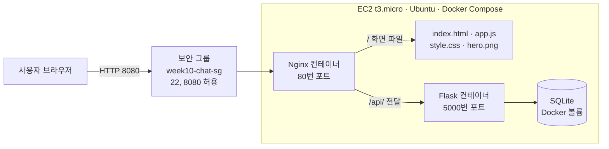

# 마운자로 진료 상담 선착순 예약 (week10_chat)

클라우드컴퓨팅 Ch.10 AWS 프로젝트 적용 과제 · 2024030 박용빈 (개인)

> 수업 과제용 데모입니다. 병원 이름·위치·가격은 모두 가상이며, 실제 진료 예약이나 의약품 판매가 아닙니다.

- 배포 주소: http://16.179.45.43:8080
- 저장소: https://github.com/bini001009-arch/week10_chat

## 1. 서비스 소개

| 항목 | 내용 |
|---|---|
| 대상 사용자 | 진료 상담을 예약하려는 환자, 예약 자리를 여는 병원 |
| 해결하려는 문제 | 인기 진료는 예약이 열리는 시각에 신청이 한꺼번에 몰린다. 정원이 정해진 자리를 먼저 신청한 순서대로 정확히 정원까지만 받아야 한다. |
| 접속이 몰리는 기능 | 예약 오픈 시각의 예약 신청 `POST /api/slots/<번호>/reservations` |

### 핵심 기능 3개

| # | 기능 | 화면 | 사용자 입력 | 확인할 결과 |
|---|---|---|---|---|
| 1 | 병원 등록 | 병원용 탭 | 병원 이름, 정원, 1회 상담 가격(엔), 지역 | 환자용 지도에 핀이 추가됨 |
| 2 | 선착순 예약 | 환자용 탭 | 지도에서 병원 선택, 예약자 성함, 상담 희망 용량 | 예약 완료 알림, 핀의 예약 수 증가 |
| 3 | 예약 현황 확인 | 환자용 탭 | 지도에서 병원 선택 | 정원, 남은 자리, 예약자 명단 |

- 지도는 실제 지도가 아니라 CSS로 그린 목업이다. 지역(신주쿠·시부야·긴자·우에노·이케부쿠로)마다 핀 위치가 정해져 있고, 한 지역에는 병원 하나만 등록된다.
- 환자용 화면에서는 지도에서 병원을 고르기 전까지 성함·용량 입력과 예약 버튼이 잠겨 있다.
- 결과와 오류는 화면 위쪽 알림(토스트)으로 표시된다.

## 2. AWS 구성도



### 사용자 요청 경로

1. 브라우저가 `http://16.179.45.43:8080` 으로 요청한다.
2. 보안 그룹이 8080번 포트 요청을 통과시킨다.
3. EC2의 8080번 포트가 Nginx 컨테이너의 80번 포트로 연결된다.
4. Nginx는 화면 파일(`/`)은 직접 돌려주고, `/api/` 요청은 Flask 컨테이너(5000번)로 넘긴다.
5. Flask가 SQLite 파일(Docker 볼륨)에 병원·예약을 저장하고 결과를 JSON으로 돌려준다.

### 사용한 AWS 서비스

| 서비스 | 역할 | 선택 이유 |
|---|---|---|
| Amazon EC2 (t3.micro, Ubuntu) | Docker Compose로 Nginx·Flask 컨테이너를 실행하는 서버 | 수업 시간에 배운 서비스이고, 로컬에서 쓰던 Compose 구성을 바꾸지 않고 그대로 올릴 수 있어서 |
| 보안 그룹 | 서버로 들어오는 포트 제한 (SSH 22, 서비스 8080) | 필요한 포트만 열기 위해 |
| EBS (gp3 8GiB) | 서버 디스크. SQLite 파일이 들어 있는 Docker 볼륨이 여기에 저장됨 | EC2 기본 저장소 |

리전은 아시아 태평양(시드니) `ap-southeast-2` 이다.

## 3. 실행·배포 방법

### 폴더 구조

```
week10_chat/
├─ compose.yaml          # Nginx·Flask를 함께 실행
├─ api/
│  ├─ app.py             # Flask API (병원 등록, 예약, 현황)
│  ├─ Dockerfile
│  └─ requirements.txt
├─ nginx/
│  ├─ nginx.conf         # / 는 화면 파일, /api/ 는 Flask로 전달
│  ├─ Dockerfile
│  └─ html/              # index.html, app.js, style.css, hero.png
└─ docs/ubuntu-docker.md # Ubuntu에 Docker 설치하는 순서
```

5주차 과제 틀(week5_workout)에서 시작했기 때문에 이미지·컨테이너 이름이 `week5_03`, `week5_api02` 처럼 5주차 이름으로 남아 있다.

### 포트

| 구간 | 포트 |
|---|---|
| 외부 접속 (브라우저 → 서버) | 8080 |
| Nginx 컨테이너 | 80 |
| Flask 컨테이너 (컨테이너 사이에서만 사용) | 5000 |

### API

| 메서드·주소 | 설명 |
|---|---|
| `GET /api/health` | 연결 확인 (학번·이름 반환) |
| `GET /api/slots` | 병원 목록 (정원, 가격, 지역, 예약된 수) |
| `POST /api/slots` | 병원 등록 |
| `GET /api/slots/<번호>/reservations` | 예약 현황 (정원, 남은 자리, 명단) |
| `POST /api/slots/<번호>/reservations` | 선착순 예약 |

### 로컬 실행 (Windows PowerShell)

준비 사항: Docker Desktop, Git

```powershell
git clone https://github.com/bini001009-arch/week10_chat.git
cd week10_chat
docker compose up -d --build
```

브라우저에서 `http://localhost:8080` 접속. 종료는 `docker compose down`.

### AWS 배포 절차

1. EC2 인스턴스 시작: Ubuntu, t3.micro, 스토리지 8GiB
2. 보안 그룹 `week10-chat-sg` 생성: SSH 22, 사용자 지정 TCP 8080 (소스 0.0.0.0/0)
3. EC2 Instance Connect로 서버에 접속 (사용자 `ubuntu`)
4. `docs/ubuntu-docker.md` 순서대로 Docker 설치 후 `sudo docker run --rm hello-world` 로 확인
5. 코드 받아서 실행

```bash
git clone https://github.com/bini001009-arch/week10_chat.git
cd week10_chat
sudo docker compose up -d --build
```

6. 브라우저에서 `http://<퍼블릭 IPv4 주소>:8080` 접속 확인

코드를 고친 뒤 서버에 반영할 때:

```bash
cd week10_chat
git pull
sudo docker compose up -d --build
```

## 4. 기능 시험 결과

배포 주소 `http://16.179.45.43:8080` 에서 직접 실행한 결과이다.

| 기능 | 구분 | 입력 | 기대 결과 | 실제 결과 |
|---|---|---|---|---|
| 1. 병원 등록 | 정상 | 병원용 탭에서 이름 `미도리 클리닉`, 정원 `2`, 가격 `22000`, 지역 `시부야` | "병원을 등록했습니다." 알림, 환자용 지도에 핀 표시 | (직접 실행 후 기입) |
| 1. 병원 등록 | 실패 | 같은 지역 `시부야`에 병원을 한 번 더 등록 | "이 지역에는 이미 병원이 등록되어 있습니다." 알림, 핀이 늘지 않음 | (직접 실행 후 기입) |
| 2. 선착순 예약 | 정상 | 미도리 클리닉 핀 선택, 성함 `홍길동`, 용량 `5mg` | "예약되었습니다." 알림, 핀이 `예약 1/2` | (직접 실행 후 기입) |
| 2. 선착순 예약 | 경계 | 정원 2명이 다 찬 뒤 세 번째 예약 (`박데모`) | "예약이 마감되었습니다." 알림, 핀이 `예약 마감` | (직접 실행 후 기입) |
| 3. 예약 현황 확인 | 정상 | 미도리 클리닉 핀 선택 | `정원 2명 · 남은 자리 1명` 과 예약자 명단 표시 | (직접 실행 후 기입) |
| 3. 예약 현황 확인 | 실패 | 병원을 선택하지 않고 `현황 확인` 버튼 클릭 | "지도에서 병원을 선택하세요." 안내, 명단 표시 없음 | (직접 실행 후 기입) |

## 5. 확장 검토 (ELB · Auto Scaling)

**적용 여부: 적용하지 않음. EC2 한 대로 운영한다.**

판단 근거:

- 과제 시연 규모에서는 동시에 접속하는 사람이 적어 EC2 한 대로 충분하다.
- 서버 수를 늘리면 그만큼 요금이 늘어난다.
- 지금 구조는 서버를 늘려도 제대로 동작하지 않는다. 예약 데이터(SQLite 파일)가 서버 안에 저장되어 있어서, 서버가 2대가 되면 데이터도 2개로 나뉜다. 한 서버에서 받은 예약이 다른 서버에서는 보이지 않고, 정원 확인도 서버마다 따로 하게 되어 정원을 넘길 수 있다.

실제 서비스로 확장한다면:

1. 예약 데이터를 서버 밖의 공용 데이터베이스(예: Amazon RDS)로 옮긴다.
2. ELB(Application Load Balancer)를 앞에 두고 요청을 여러 서버에 나눈다. 상태 검사는 `/api/health` 를 사용한다.
3. Auto Scaling으로 예약 오픈 시각처럼 요청이 몰릴 때만 서버 수를 늘리고, 한가해지면 줄인다. 최대 서버 수를 정해 요금을 제한한다.

## 6. 한계와 개선할 점

- 로그인이 없다. 병원용 탭은 누구나 열 수 있고, 예약 현황에 예약자 성함이 그대로 보인다. 실제 서비스라면 병원 계정 로그인이 필요하고, 현황에는 남은 자리 수만 보여야 한다.
- HTTPS를 적용하지 않았다 (HTTP 8080).
- 예약 취소 기능이 없다.
- 5주차 틀의 조회수·소개 다운로드 API(`/api/views`, `/api/download`)가 코드에 남아 있지만 화면에서는 사용하지 않는다.
- 서버가 재부팅되면 컨테이너를 `sudo docker compose up -d` 로 다시 켜야 한다.

## 7. AI 활용

사용 도구: Claude (채팅). 에이전틱 코딩 도구(Claude Code, Cursor 등)는 사용하지 않았다.

| 구분 | 내용 |
|---|---|
| 설명을 듣고 직접 작성 | 병원·예약 테이블, 병원 등록·목록 API, 상담 희망 용량 선택 기능 |
| AI가 준 코드 조각을 직접 삽입·수정 | 병원 가격·지역 항목, 목업 지도와 핀, 알림(토스트) |
| AI가 작성·수정한 파일을 적용 | 선착순 예약·현황 API, 초기 화면(index.html·app.js), 환자용·병원용 탭 분리와 화면 배치, 병원 선택 전 입력 잠금 |
| AI가 찾아 수정한 오류 | 병원 등록 검사 코드의 들여쓰기 오류(검사가 실행되지 않던 문제), 알림 함수 호출 오류 |
| 그림 | 머리말 그림은 이라스토야 그림에 AI가 그린 주사 펜 아이콘을 합친 것 |
| 안내를 받아 직접 수행 | EC2 인스턴스 생성, 보안 그룹 설정, Docker 설치, 배포 |
| 문서 | README 초안을 AI가 작성하고 본인이 검토·수정 |
| 직접 확인한 결과 | 로컬과 배포 주소에서 기능 3개의 정상·실패 동작을 직접 실행해 확인 (4번 표) |

## 8. 검사 후 자원 정리

- 검사 완료까지 EC2 인스턴스를 실행 상태로 유지한다. (중지 후 다시 켜면 퍼블릭 주소가 바뀐다.)
- 검사 완료 후 인스턴스를 중지하고, 이후 인스턴스·보안 그룹·키 페어를 삭제한다.
- GitHub 저장소와 README는 보존한다.

## 9. 출처

- 머리말의 병원·의사 그림: いらすとや (irasutoya)
- 주사 펜 아이콘, 목업 지도: 직접 제작 (AI 활용)
